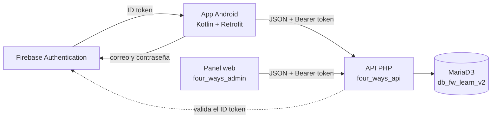
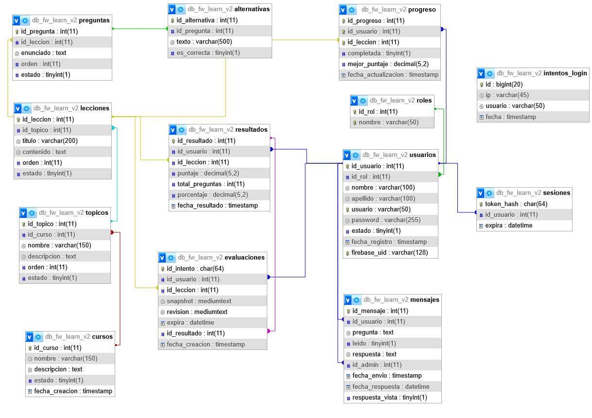
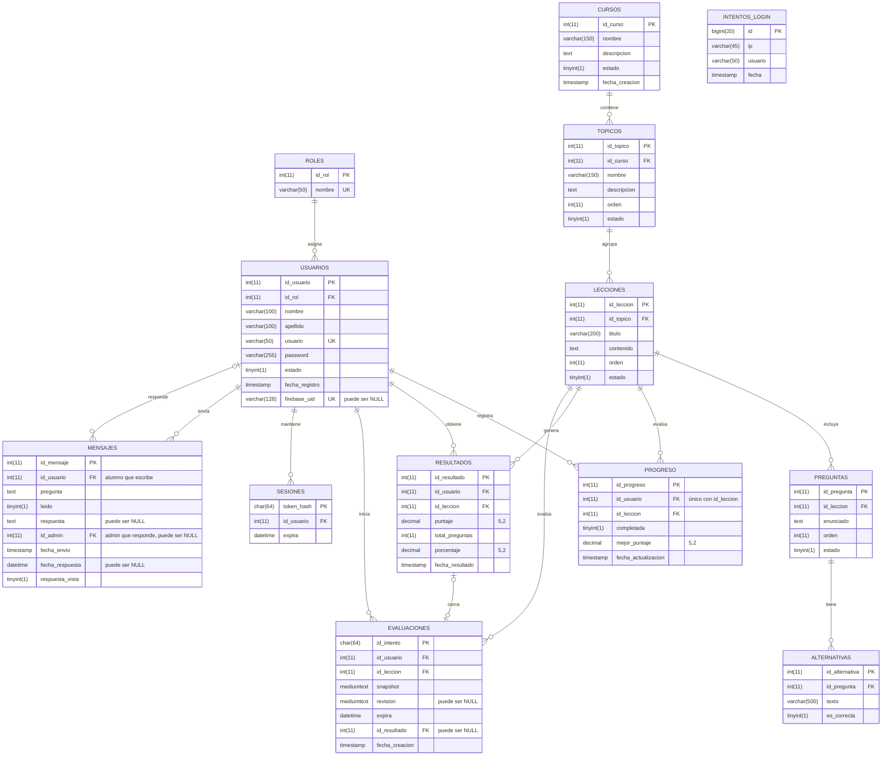

<div align="center">

# Four Ways Learn

**Plataforma para aprender programación: app Android para alumnos, API REST y panel web de administración.**


</div>

Four Ways Learn organiza el aprendizaje en **cursos, temas y lecciones**. Cada lección termina con una evaluación, y el progreso del alumno queda registrado para que pueda retomar donde lo dejo.
Los administradores gestionan todo el contenido, revisa resultados y responden las consultas de los alumnos desde un panel web.

Es un proyecto académico formado por tres piezas que comparten una misma base de datos.

## Contenido
- [Funcionalidades](#funcionalidades)
- [Arquitectura](#arquitectura)
- [Estructura del repositorio](#estructura-del-repositorio)
- [Requisitos](#requisitos)
- [Instalación](#instalación)
- [Cuentas de prueba](#cuentas-de-prueba)
- [Configuración de Firebase](#configuración-de-firebase)
- [Referencia de la API](#referencia-de-la-api)
- [Modelo de datos](#modelo-de-datos)
- [Capturas](#capturas)
- [Solución de problemas](#solución-de-problemas)
- [Seguridad](#seguridad)

## Funcionalidades
### App Android: alumno

- Inicio de sesión con correo y contraseña mediante Firebase Authentication.
- Catálogo de cursos y temas, con consulta sin conexión gracias a una caché local en SQLite.
- Lecciones con el contenido dividido en secciones.
- Evaluaciones con alternativas y retroalimentación al terminar cada intento.
- Progreso por curso, tema y lección, más el historial de resultados.
- **Mensajes al administrador:** el alumno envía una consulta desde su cuenta y luego lee la respuesta en "Mis Mensajes", con un aviso cuando hay una respuesta nueva.

### App Android: administrador
- Panel con los módulos del sistema.
- Alta, edición y baja lógica de cursos, temas, lecciones, preguntas y usuarios.
- Consulta de resultado estadísticas.

### Panel Web
- Las mismas funciones de administración, desde el navegador.
- **Bandeja de mensajes:** cada consulta aparece como una tarjeta con el nombre del alumno, su estado (leído o sin leer, contestado o sin contestar), la pregunta y el botón *Responder*. Incluye filtros y contadores.
- Borrado definitivo de registros (en caso sea necesario), además de la baja lógica.

## Arquitectura



**Flujo de autenticación**

1. La app inicia sesión en Firebase, y obtiene un *ID token*.
2. Envía ese token a `login_firebase.php`, que lo valida contra Firebase, comprueba que la cuenta esté activa y localiza al usuario por `firebase_uid`.
3. La API emite un **token de sesión propio** (64 caracteres hexadecimales). Solo se guarda su hash en la tabla `sesiones`.
4. El resto de las peticiones viajan con la cabecera `Authorization: Bearer <token>`.

El panel web sigue el mismo esquema de sesión, pero entra por `login.php` con usuario y contraseña de la tabla `usuarios`.

## Estructura del repositorio

```
FW_LEARN/          App Android (Gradle). Esta carpeta se abre en Android Studio.
four_ways_api/     API PHP. Se copia a C:\xampp\htdocs\
four_ways_admin/   Panel web. Se copia a C:\xampp\htdocs\
database/          Script SQL de la base de datos.
docs/              Capturas e imágenes de la documentación.
```

**Tecnologías**

| Capa | Stack |
|---|---|
| Android | Kotlin, ViewBinding, RecyclerView, Retrofit + Gson, SQLite, SharedPreferences, Firebase Authentication |
| API | PHP 8, MYSQL con consultas preparadas, cURL, Apache |
| Base de datos | MariaDB / MySQL |
| Panel web | HTML, CSS y JavaScript sin frameworks |

## Requisitos

- **Android Studio** con JDK 17 y el SDK de Android API 36.1.
- **XAMPP** con Apache, MariaDB y PHP 8 (extensión `curl` habilitada).
- Un **proyecto de Firebase** con el método *Correo electrónico/contraseña* activado.


## Instalación

### 1. Base de datos 

1. Inicia **Apache** y **MySQL** desde el panel de XAMPP.
2. Abre `http://localhost/phpmyadmin/` y crea la base **`db_fw_learn_v2`** con cotejamiento `utf8mb4_general_ci`.
3. Selecciónala e importa `database/db_fw_learn_v2.sql`. El script icluye la tabla `mensajes`.
4. Si usas otro usuario o contraseña de MariaDB, ajústalos en `four_ways_api/config/conexion.php`.

### 2. API

Copia `four_ways_api` a `C:\xampp\htdocs\` y comprueba que responde:

```
http://localhost/four_ways_api/api/health.php
```

### 3. Panel web

Copia `four_ways_admin` a `C:\xampp\htdocs\` y abre `http://localhost/four_ways_admin/`.

El archivo `four_ways_admin/js/config.js` apunta a `/four_ways_api/api/`, así que ambas carpetas deben quedar dentro de `htdocs`.

### 4. App Android

1. Abre la carpeta `FW_LEARN`, la que contiene `settings.grade.kts`, en Android Studio.
2. En `gradle.properties` deja **una sola** línea `FW_API_BASE_URL`:


```properties
   # Emulador
   FW_API_BASE_URL=http://10.0.2.2/four_ways_api/api/
 
   # Celular físico en la misma red (usa la IPv4 de tu PC)
   FW_API_BASE_URL=http://192.168.1.72/four_ways_api/api/
```
La url debe terminar en `/`.
3. Agrega que exista `FW_LEARN/app/google-services.json`. Este archivo no está en el repositorio; se descarga desde tu proyecto de Firebase (ver [Configuración de Firebase](#configuración-de-firebase)).
4. Sincroniza Gradle y ejecuta la app, con Apache y MySQL encendidos. 

## Cuentas de prueba

El respositorio no incluye contraseñas: cada persona crea las suyas.

**App Android (Firebase)**

1. En la consola de Firebase, en *Authentication → Users*, crea una cuenta de administrador y una de alumno con el correo y la contraseña que quieras.
2. Copia el **UID** de cada cuenta y guárdalo en la base de datos:
   
```sql
   UPDATE usuarios SET firebase_uid = 'UID_DE_FIREBASE' WHERE usuario = 'admin';
   UPDATE usuarios SET firebase_uid = 'UID_DE_FIREBASE' WHERE usuario = 'alumno';
```

**Panel web**

El panel valida contra la tabla `usuarios`, con el nombre de usuario (`admin`). Para fijar tu propia contraseña, genera el hash y guárdalo:

```
php -r "echo password_hash('TU_CONTRASEÑA', PASSWORD_DEFAULT);"
```
 
```sql
UPDATE usuarios SET password = 'EL_HASH_GENERADO' WHERE usuario = 'admin';
```

Si vuelves a crear una cuenta en Firebase, su UID cambia: actualiza `usuarios.firebase_uid`.

## Configuración de Firebase

Los archivos con claves no se versionan (están en `.gitignore`). Cada persona crea los suyos:

| Archivo | Para qué sirve | Cómo obtenerlo |
|---|---|---|
| `FW_LEARN/app/google-services.json` | Conecta la app Android con Firebase. | Consola de Firebase → *Configuración del proyecto* → *Tus apps* → Android → descargar. |
| `four_ways_api/config/firebase.php` | La API valida el ID token (`project_id` y `api_key`). | Ambos valores están en *Configuración del proyecto → General*. |
| `four_ways_api/config/conexion.php` | Credenciales de MariaDB. | Las de tu XAMPP. |

Pasos en la consola de Firebase:

1. Crea el proyecto y registra la app Android con el paquete `com.example.four_ways_learn`.
2. Activa **Authentication → Correo electrónico/contraseña**.
3. Crea las cuentas de prueba.
4. Copia el **UID** de cada cuenta en `usuarios.firebase_uid`.

## Referencia de la API

Todas las respuestas, salvo `health.php`, usan este formato:

```json
{"success": true, "data": {}, "mensaje": ""}
```

**Sesión**

| Método | Ruta | Descripción |
|---|---|---|
| POST | `login_firebase.php` | Inicia sesión con el ID token de Firebase (app). |
| POST | `login.php` | Inicia sesión con usuario y contraseña (panel web). |
| GET | `me.php` | Devuelve el usuario de la sesión. |
| POST | `logout.php` | Cierra la sesión. |
 
**Contenido y evaluaciones (alumno)**
 
| Método | Ruta | Descripción |
|---|---|---|
| GET | `cursos.php` | Cursos activos. |
| GET | `topicos.php?curso_id=` | Temas de un curso. |
| GET | `lecciones.php?topico_id=` | Lecciones de un tema. |
| GET | `leccion.php?id=` | Lección con su contenido. |
| GET | `avance.php` | Progreso general del alumno. |
| POST | `evaluaciones.php` | Inicia una evaluación. |
| POST | `enviar_evaluacion.php` | Envía las respuestas y devuelve el resultado. |
| GET | `resultados.php` | Historial de resultados del alumno. |
 
**Mensajes**
 
| Método | Ruta | Quién lo usa | Descripción |
|---|---|---|---|
| POST | `mensaje_enviar.php` | Alumno | Envía una consulta al administrador. Límite de 10 por hora. |
| GET | `mensajes_alumno.php` | Alumno | Lista sus mensajes con las respuestas. |
| POST | `mensajes_alumno.php` | Alumno | Marca una respuesta como vista. |
| GET | `mensajes.php` | Admin | Bandeja con todos los mensajes. |
| POST | `mensaje_leer.php` | Admin | Marca un mensaje como leído. |
| POST | `mensaje_responder.php` | Admin | Guarda la respuesta a un mensaje. |
 
**Administración**
 
| Método | Ruta | Descripción |
|---|---|---|
| GET, POST, PUT, DELETE | `admin.php?recurso=` | Consulta, alta, edición y baja lógica. Recursos: `cursos`, `topicos`, `lecciones`, `preguntas`, `usuarios`, `resultados`, `estadisticas`. |
| DELETE | `admin_eliminar.php?recurso=` | Borrado definitivo (panel web). |
| GET | `health.php` | Comprobación de estado del servicio. |

## Modelos de datos 

### Modelo relacional 

Diagrama generado con el diseñador de phpMyAdmin 



<details>
<summary>Ver el diagrama como código Mermaid</summary>
    

 
`INTENTOS_LOGIN` solo registra los intentos de acceso (IP, usuario y fecha) y no tiene clave foránea.
 
</details>    

### Reglas de integridad

| Relación (hija → padre) | Al borrar el padre | Al actualizar el padre |
|---|---|---|
| `usuarios.id_rol` → `roles` | Se bloquea el borrado | Se actualiza |
| `topicos.id_curso` → `cursos` | Se borran los temas | Se actualiza |
| `lecciones.id_topico` → `topicos` | Se borran las lecciones | Se actualiza |
| `preguntas.id_leccion` → `lecciones` | Se borran las preguntas | Se actualiza |
| `alternativas.id_pregunta` → `preguntas` | Se borran las alternativas | Se actualiza |
| `progreso` y `resultados` → `usuarios` y `lecciones` | Se borran los registros | Se actualiza |
| `evaluaciones.id_usuario` y `id_leccion` | Se borran los intentos | |
| `evaluaciones.id_resultado` → `resultados` | Queda en `NULL` | |
| `sesiones.id_usuario` → `usuarios` | Se borran las sesiones | |
| `mensajes.id_usuario` → `usuarios` | Se borran sus mensajes | Se actualiza |
| `mensajes.id_admin` → `usuarios` | Queda en `NULL` (el mensaje se conserva) | Se actualiza |
 
Índices únicos: `usuarios.usuario`, `usuarios.firebase_uid`, `roles.nombre` y la pareja `progreso(id_usuario, id_leccion)`.

### Caché local en Android (SQLite)

| Tabla | Clave primaria | Campos |
|---|---|---|
| `cursos` | `(id_usuario, id_curso)` | nombre, descripcion, total_lecciones, lecciones_completadas, porcentaje_avance |
| `topicos` | `(id_usuario, id_curso, id_topico)` | nombre, descripcion, orden, estado, total_lecciones, lecciones_completadas, porcentaje_avance |
 
La sesión del alumno se guarda en `SharedPreferences` (`fw_session_v2`): el token de la API y los datos del usuario en JSON.

