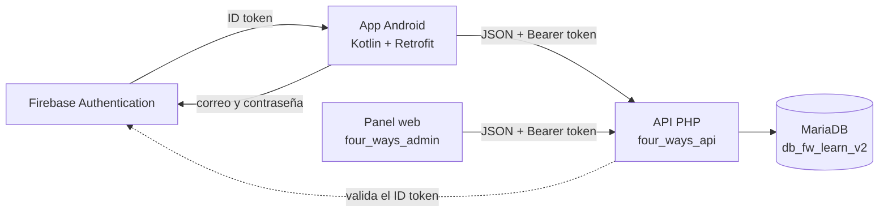

<div align="center">

# Four Ways Learn

**Plataforma para aprender programación: app Android para alumnos, API REST y panel web de administración.**


</div>

Four Ways Learn organiza el aprendizaje en **cursos, temas y lecciones**. Cada lección termina con una evaluación, y el progreso del alumno queda registrado para que pueda retomar donde lo dejo.
Los administradores gestionan todo el contenido, revisa resultados y responden las consultas de los alumnos desde un panel web.

Es un proyecto académico formado por tres piezas que comparten una misma base de datos.

## Contenido
- [Funcionalidades](#funcionalidades)
- [Arquitectura](#arquitectura)
- [Estructura del repositorio](#estructura-del-repositorio)
- [Requisitos](#requisitos)
- [Instalación](#instalación)
- [Cuentas de demostración](#cuentas-de-demostración)
- [Referencia de la API](#referencia-de-la-api)
- [Modelo de datos](#modelo-de-datos)
- [Capturas](#capturas)
- [Solución de problemas](#solución-de-problemas)
- [Seguridad](#seguridad)

## Funcionalidades
### App Android: alumno

- Inicio de sesión con correo y contraseña mediante Firebase Authentication.
- Catálogo de cursos y temas, con consulta sin conexión gracias a una caché local en SQLite.
- Lecciones con el contenido dividido en secciones.
- Evaluaciones con alternativas y retroalimentación al terminar cada intento.
- Progreso por curso, tema y lección, más el historial de resultados.
- **Mensajes al administrador:** el alumno envía una consulta desde su cuenta y luego lee la respuesta en "Mis Mensajes", con un aviso cuando hay una respuesta nueva.

### App Android: administrador
- Panel con los módulos del sistema.
- Alta, edición y baja lógica de cursos, temas, lecciones, preguntas y usuarios.
- Consulta de resultado estadísticas.

### Panel Web
- Las mismas funciones de administración, desde el navegador.
- **Bandeja de mensajes:** cada consulta aparece como una tarjeta con el nombre del alumno, su estado (leído o sin leer, contestado o sin contestar), la pregunta y el botón *Responder*. Incluye filtros y contadores.
- Borrado definitivo de registros (en caso sea necesario), además de la baja lógica.

## Arquitectura



**Flujo de autenticación**

1. La app inicia sesión en Firebase, y obtiene un *ID token*.
2. Envía ese token a `login_firebase.php`, que lo valida contra Firebase, comprueba que la cuenta esté activa y localiza al usuario por `firebase_uid`.
3. La API emite un **token de sesión propio** (64 caracteres hexadecimales). Solo se guarda su hash en la tabla `sesiones`.
4. El resto de las peticiones viajan con la cabecera `Authorization: Bearer <token>`.

El panel web sigue el mismo esquema de sesión, pero entra por `login.php` con usuario y contraseña de la tabla `usuarios`.

## Estructura del repositorio

```
FW_LEARN/          App Android (Gradle). Esta carpeta se abre en Android Studio.
four_ways_api/     API PHP. Se copia a C:\xampp\htdocs\
four_ways_admin/   Panel web. Se copia a C:\xampp\htdocs\
database/          Script SQL de la base de datos.
docs/              Capturas e imágenes de la documentación.
```

**Tecnologías**

| Capa | Stack |
|---|---|
| Android | Kotlin, ViewBinding, RecyclerView, Retrofit + Gson, SQLite, SharedPreferences, Firebase Authentication |
| API | PHP 8, MYSQL con consultas preparadas, cURL, Apache |
| Base de datos | MariaDB / MySQL |
| Panel web | HTML, CSS y JavaScript sin frameworks |

## Requisitos

- **Android Studio** con JDK 17 y el SDK de Android API 36.1.
- **XAMPP** con Apache, MariaDB y PHP 8 (extensión `curl` habilitada).
- Un **proyecto de Firebase** con el método *Correo electrónico/contraseña* activado.

